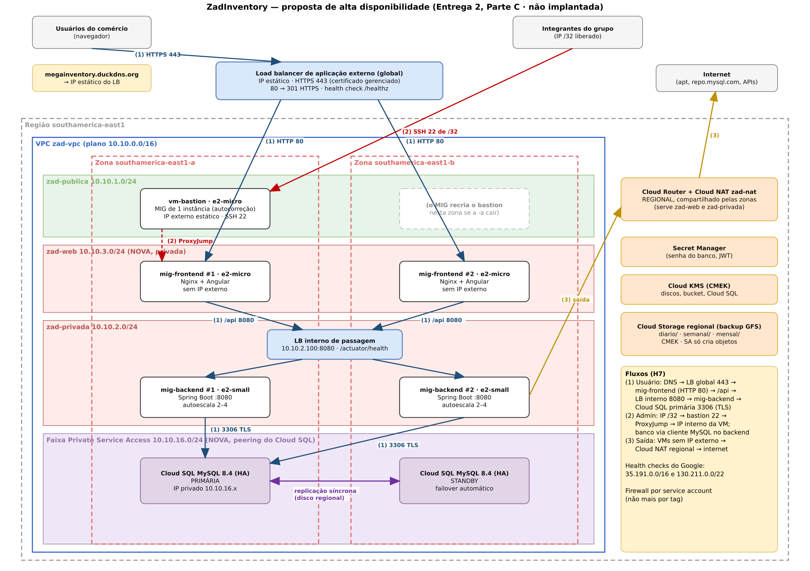

# Alta disponibilidade (Parte C, projetada, não implantada)

Decisão registrada no [ADR-004](adr/004-alta-disponibilidade.md). A arquitetura implantada continua a da Entrega 1 (uma VM por função na zona `-a`), mantida em `docs/diagramas/arquitetura.drawio` para comparação.

Fonte editável: [`diagramas/arquitetura-ha.drawio`](diagramas/arquitetura-ha.drawio) (abre no diagrams.net).

## Visão geral

| Camada | Implantada (Entrega 1) | Proposta de HA |
|---|---|---|
| Zonas | Só `southamerica-east1-a` | `-a` e `-b` |
| Entrada | IP estático da `vm-frontend` | Load balancer de aplicação externo global, com IP estático e certificado gerenciado |
| Frontend | 1× `vm-frontend` com IP externo | MIG regional `mig-frontend`: 2× e2-micro (uma por zona), **sem IP externo** |
| API | 1× `vm-backend` | LB interno de passagem `10.10.2.100:8080` → MIG regional `mig-backend`: 2 a 4× e2-small |
| Banco | 1× `vm-db` (MySQL em VM) | Cloud SQL for MySQL 8.4 HA: primária em `-a`, standby síncrona em `-b` |
| NAT | Cloud NAT regional | O mesmo Cloud NAT regional, agora atendendo `zad-web` e `zad-privada` |
| Bastion | 1 VM | MIG de 1 instância com autocorreção |
| Firewall | Por tag de rede | Por service account (`target_service_accounts`) |

## H1. Duas zonas e endereçamento atualizado

Na GCP a **sub-rede é regional**: uma mesma sub-rede tem endereços utilizáveis em todas as zonas da região. Por isso a distribuição entre zonas não é feita criando "uma sub-rede por zona", como na AWS, mas pela **política de distribuição dos MIGs regionais** (`distribution_policy_zones = [a, b]`), que espalha as instâncias igualmente entre as zonas e recria na zona que sobrou se uma cair.

| Sub-rede / faixa | CIDR | Tipo | Recursos | Mudança |
|---|---|---|---|---|
| `zad-publica` | 10.10.1.0/24 | Pública (rota para o internet gateway, VMs com IP externo) | `vm-bastion` (MIG de 1) | Frontend sai dela |
| `zad-web` | **10.10.3.0/24** | Privada (sem IP externo, saída pelo NAT) | `mig-frontend` (2 VMs) | **Nova**. O frontend deixa de ter IP público: só o load balancer fala com ele |
| `zad-privada` | 10.10.2.0/24 | Privada | `mig-backend` (2–4 VMs); IP do LB interno **10.10.2.100** reservado | VIP do LB interno |
| Private Service Access | **10.10.16.0/24** | Faixa alocada para o peering de serviço do Google | Cloud SQL (primária e standby) | **Nova**. Reservada com `google_compute_global_address` (`purpose = VPC_PEERING`) |
| Faixas do Google (origem) | 35.191.0.0/16, 130.211.0.0/22 | Health checks e proxies do LB | - | Liberadas no firewall para as portas 80 (frontend) e 8080 (backend) |

O bloco de planejamento 10.10.0.0/16 continua comportando as novas faixas sem sobreposição.

## H2. Balanceamento e health checks

| Balanceador | Distribui para | Health check | Ação em falha |
|---|---|---|---|
| **LB de aplicação externo global** (HTTPS 443; regra separada na porta 80 só redireciona para 443) | `mig-frontend`, porta 80 | HTTP `GET /healthz` (bloco `location = /healthz { return 200; }` no Nginx), a cada 10 s, 2 sucessos / 3 falhas | Para de enviar tráfego à instância; a **autocorreção do MIG** (health check com atraso inicial de 300 s) recria a VM |
| **LB interno de passagem** (TCP 8080, `10.10.2.100`) | `mig-backend` | HTTP `GET /actuator/health` na 8080 | Idem; o Nginx do frontend aponta para o VIP, não para um IP de VM |

- `mig-backend` com **autoescalonamento**: mínimo 2, máximo 4, alvo de 60% de CPU, resolvendo o limite de CPU compartilhada (risco 6).
- O certificado TLS passa a ser **gerenciado pelo Google** no LB (renovação automática); o DuckDNS aponta uma única vez para o IP estático global do LB e não precisa mais ser atualizado a cada `apply`.

## H3. Estratégia de NAT: um NAT regional compartilhado

**Escolha: manter um único Cloud NAT (`zad-nat`) regional, compartilhado pelas duas zonas.**

Na GCP o Cloud NAT não é uma VM nem um gateway alocado numa zona (como o NAT Gateway da AWS, que vive numa subnet de uma AZ). Ele é configurado no Cloud Router e implementado de forma distribuída na rede definida por software do Google, em cada host. **A falha de uma zona não derruba o NAT das VMs da outra zona.** Criar dois gateways não aumentaria a disponibilidade.

Consequências da escolha:
- **Custo:** um IP de NAT e um gateway; o custo cresce só com o número de VMs atendidas (US$ 0,0014/VM/h), de 2 para 4 VMs no mínimo (até 6 com o backend escalado).
- **IP de saída único:** todos os destinos externos veem o mesmo IP. Com 64 portas por VM (padrão), 6 VMs usam ~384 das ~64 mil portas do IP: sem risco de esgotamento nesse porte.
- **Raio de impacto:** um erro de configuração no NAT ou no Cloud Router afeta as duas zonas ao mesmo tempo. Aceito: a aplicação continua atendendo usuários sem NAT, porque o NAT só é usado para saída (pacotes, APIs); o tráfego dos usuários entra pelo LB.

## H4. Banco de dados: Cloud SQL HA

**Escolha: Cloud SQL for MySQL 8.4, edição Enterprise, configuração HA (regional), `db-custom-1-3840`, IP privado.**

- Primária em `-a`, standby em `-b`, com **disco regional replicado de forma síncrona**: toda transação confirmada já está nas duas zonas. Na falha da zona ou da primária, o Cloud SQL faz **failover automático** em cerca de um minuto, mantendo o mesmo IP. O backend só reconecta.
- Backups automáticos diários (7 dias) com **PITR**; o dump lógico do [ADR-005](adr/005-backup.md) continua gerando as gerações semanal e mensal.
- `require_secure_transport` ligado (S3), CMEK com a chave `zad-disco` (S6), acesso só pela faixa de Private Service Access.

Alternativa descartada: **réplica MySQL própria** em VM na zona `-b` (mais barata, ~US$ 108/mês a menos no total, mas com failover manual, risco de perder transações na replicação assíncrona e operação de replicação pelo grupo). Detalhes no ADR-004.

## H5. Estado fora da instância

| Estado | Onde fica hoje | Na proposta | Por que qualquer instância atende qualquer requisição |
|---|---|---|---|
| **Sessão do usuário** | **Não há sessão no servidor**: o Spring Security roda com `SessionCreationPolicy.STATELESS` e o usuário envia o JWT a cada chamada | Igual | O JWT é validado com o segredo `zad-jwt-secret`, o mesmo para todas as instâncias de `mig-backend` (lido do Secret Manager no boot) |
| **Arquivos enviados** | **A aplicação não recebe uploads** (nenhum `MultipartFile` no backend) | Se um dia houver: bucket do Cloud Storage, nunca o disco da VM | - |
| **Dados de negócio** | MySQL na `vm-db` | Cloud SQL HA | Todas as instâncias do backend usam o mesmo endpoint privado |
| Arquivos do Angular | Disco da `vm-frontend` | Copiados em cada instância pelo template do MIG (ou servidos de um bucket pelo LB) | Conteúdo estático idêntico em todas |
| Logs | Journal da VM | Cloud Logging (agente de operações) | A VM pode ser destruída a qualquer momento pelo MIG |

Afinidade de sessão no LB: **desnecessária**.

## H6. Pontos únicos de falha da seção 5.10 da Entrega 1

| # | Limitação (Entrega 1) | Na proposta | Como |
|---|---|---|---|
| 1 | `vm-db` única, sem réplica | **Eliminado** | Cloud SQL HA com standby síncrona em outra zona e failover automático |
| 2 | Zona única | **Eliminado** | MIGs regionais em `-a` e `-b`; Cloud SQL regional; NAT e LB são regionais/globais |
| 3 | `vm-frontend` é a única porta de entrada | **Eliminado** | LB externo global com 2+ instâncias de frontend e health check |
| 4 | `vm-bastion` é ponto único do acesso administrativo | **Mitigado e aceito** | MIG de 1 instância com autocorreção: é recriada sozinha (em outra zona se preciso) em poucos minutos. Um segundo bastion não se justifica, porque a falha dele não afeta os usuários |
| 5 | IPs residenciais dinâmicos na regra de SSH | **Aceito** | Não é disponibilidade da aplicação; continua o procedimento de atualizar `admin_ssh_cidrs` e rodar `apply` |
| 6 | CPU compartilhada (E2) | **Eliminado** | Autoescalonamento do `mig-backend` de 2 a 4 instâncias por CPU |
| 7 | Saída irrestrita pelo NAT | **Já tratado na Entrega 2** | Controle S2 (errata E2); continua na proposta |
| 8 | Firewall por tag | **Eliminado** | Regras com `target_service_accounts` / `source_service_accounts`: trocar a SA exige parar a VM e permissão `iam.serviceAccountUser`, não só editar tags |
| 9 | Destruir o ambiente apaga os dados | **Eliminado em operação contínua** | Banco gerenciado não é destruído entre sessões; backups automáticos + GFS |
| 10 | TLS depende do DuckDNS e do Let's Encrypt | **Mitigado** | Certificado gerenciado pelo Google, renovado pelo próprio LB; o DuckDNS continua sendo dependência de DNS (aceito: em produção, domínio próprio no Cloud DNS) |

## H7. Fluxos redesenhados

| Fluxo | Caminho na proposta |
|---|---|
| **(1) Usuário acessando a aplicação** | Navegador → DNS `megainventory.duckdns.org` → IP anycast do **LB global** (TLS termina no LB) → backend service `mig-frontend` em HTTP 80, só instâncias saudáveis, na zona mais próxima/disponível → Nginx serve o Angular; `/api/*` → Nginx → **LB interno `10.10.2.100:8080`** → instância saudável de `mig-backend` → **Cloud SQL primária** (IP privado da faixa PSA, TLS) → resposta pelo mesmo caminho. A standby recebe cada escrita de forma síncrona |
| **(2) Administrador via SSH** | Máquina do integrante (IP /32) → SSH 22 → IP estático do **bastion** → ProxyJump → IP interno da instância desejada (`gcloud compute instances list --filter="name~mig-"`, já que os IPs dos MIGs não são fixos). Banco: cliente `mysql` a partir de uma instância do backend, com TLS, ou Cloud SQL Auth Proxy no bastion |
| **(3) Instância privada saindo para a internet** | Instâncias de `mig-frontend` e `mig-backend` (sem IP externo) → rota `0.0.0.0/0` → **Cloud NAT regional** → internet (apt, APIs). O Cloud SQL não usa o NAT do grupo |

## Custo da alta disponibilidade

Estimativa em operação contínua (730 h/mês) na **calculadora oficial** (Google Cloud Pricing Calculator), região São Paulo, preços de 21/11/2026:
**<https://cloud.google.com/products/calculator?dl=CjhDaVF6Tm1RNE9HTTVaaTA1TTJSbUxUUTNNR1l0WVRBNU1TMHpNMlUyTmpJM016Qm1OemtRQVE9PRAOGiRFQTUwODg2OS00MDgwLTREMjctODAxOS0yMTFENUY2RjA1QjE>**. Exportação por SKU: [`custos/estimativa-ha-calculadora.csv`](custos/estimativa-ha-calculadora.csv).

| Item na calculadora | Configuração | Custo mensal |
|---|---|---|
| Front + Bastion (Compute Engine) | 3× e2-micro (2 `mig-frontend` + bastion), 3× 10 GB `pd-standard` | US$ 30,92 |
| Back (Compute Engine) | 2× e2-small (`mig-backend`, mínimo do autoescalonamento), 2× 20 GB `pd-balanced` | US$ 44,83 |
| **MySQL (Cloud SQL)** | Enterprise, **HA regional**, 1 vCPU, 3,75 GiB, 10 GB SSD, 1 GB de backup | **US$ 153,15** |
| Cloud Load Balancing | 3 regras de encaminhamento (443 e 80 do externo + 1 do interno), 2 GiB de entrada e 2 GiB de saída | US$ 27,79 |
| Cloud NAT | Gateway para 4 VMs + 1 IP + 2 GiB processados | US$ 7,83 |
| **Total (calculadora)** | | **US$ 264,51** |

Observações sobre a estimativa:
- A calculadora agrupa os dois balanceadores num único item regional, cobrado pelo mínimo de regras de encaminhamento (SKU *Regional External Proxy Network Load Balancer Forwarding Rule Minimum*). Com o externo global e o interno separados, o item ficaria em ~US$ 37, ou seja, ~US$ 9 a mais.
- Não foram lançados o IP externo do bastion (US$ 1,83) nem o egress de 2 GiB (US$ 0,38). Somados, o total iria a ~US$ 266,72; a diferença não altera a conclusão.
- Os itens de KMS e Secret Manager (~US$ 0,30) existem nos dois cenários e foram deixados de fora da comparação.

| Versão | Custo mensal estimado | Variação |
|---|---|---|
| Arquitetura implantada (Entrega 1, cenário A) | US$ 75,25 | - |
| **Proposta de alta disponibilidade** | **US$ 264,51** | **+252%** |
| (Alternativa: réplica MySQL própria em vez do Cloud SQL) | US$ 156,19 | +108% |

**Itens que mais contribuem para o aumento** (+US$ 189,26):
1. **Cloud SQL HA: +US$ 153,15** (81% do aumento). A e2-small que era a `vm-db` passa a ser a segunda instância do backend, então o banco gerenciado entra como item novo, e o modo HA cobra vCPU e memória em dobro pela standby.
2. **Balanceamento de carga: +US$ 27,79** (15%). Cobrado por hora pelas regras de encaminhamento, mesmo sem tráfego.
3. **Demais itens: +US$ 8,32** (4%): segundo frontend (+US$ 9,71), um disco a mais (+US$ 0,60), NAT atendendo mais VMs (+US$ 2,05), IPs externos das VMs e egress não lançados (−US$ 4,03).

**Esse custo se justifica para o perfil da seção 5.1? Não.** O ZadInventory atende até 20 usuários de um comércio pequeno em horário comercial, com RTO de 1 h e RPO de 24 h aceitos. Uma falha de VM ou zona é rara; quando ocorre, o grupo recria tudo com `terraform apply` + `deploy.sh` + restauração do dump dentro de 1 h, e o comércio continua vendendo com anotações no papel nesse intervalo. Pagar **3,5 vezes mais (~US$ 2.270 a mais por ano)** para evitar algumas horas de indisponibilidade por ano não compensa para o faturamento de um comércio desse porte. A proposta passa a se justificar se o sistema operar 24×7, atender várias lojas simultaneamente ou tiver vendas online, quando cada hora parada custa mais que a diferença mensal. Um passo intermediário mais barato seria só o LB com dois frontends e o Cloud SQL **sem** HA (zonal), aceitando o banco como ponto único com backup.
